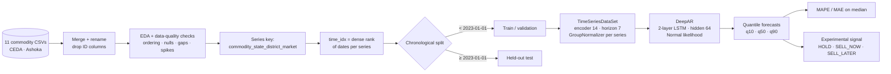

<div align="center">

# 📈 Probabilistic Forecasting of Indian Mandi Prices

**A global DeepAR model for 7-day, uncertainty-aware price forecasts across thousands of commodity × market series, and a detailed account of why sparse public market data limited it.**


[Dataset](#dataset) · [Findings](#what-the-data-revealed) · [The sparsity problem](#the-core-problem-irregular-sparse-series) · [Model](#modeling-approach) · [Next steps](#what-i-would-do-next)

</div>

---

## Overview

Indian agricultural prices swing sharply with season, region and supply shocks. Daily mandi prices are public, but they rarely become forward-looking guidance a farmer can use. The goal was a **decision-support forecaster**: for any commodity in any market, predict the next 7 days **as a probability distribution** (10th, 50th and 90th percentiles), not a single number that sounds more certain than it is.

The task is a **multi-series, univariate, probabilistic forecasting problem**, handled with one *global* model trained across all commodity × market series.

> **Status: paused.** The data pipeline, EDA, DeepAR training and the evaluation harness are built, and the model trains on GPU. I paused before final evaluation because the data turned out to be extremely irregular: most series have large, uneven gaps, which made a daily-step model unreliable. The [sparsity section](#the-core-problem-irregular-sparse-series) explains the diagnosis, and [next steps](#what-i-would-do-next) lists how I would fix it.

---

## Dataset

Daily wholesale prices from the **Agricultural Market dataset published by [CEDA, Ashoka University](https://ceda.ashoka.edu.in/)**, a cleaned, structured compilation of Agmarknet mandi reports. It was downloaded as one CSV per commodity and merged.

| | |
|---|---|
| **Records** | **2,496,630** daily price observations |
| **Time span** | Dec 2015 → Oct 2025 (~10 years) |
| **Commodities** | 11: tomato, onion, potato, paddy, rice, wheat, maize, jowar, ragi, barley, apple |
| **Coverage** | 2,477 markets · 527 districts · 32 states and UTs |
| **Fields** | date, commodity, variety, market, district, state, min / modal / max price (₹ per quintal) |
| **Target** | `p_modal`, the modal (most common) traded price |

Each series is one **commodity × state × district × market** combination, for example `Potato_Rajasthan_Ajmer_Ajmer(F&V)`.

---

## What the data revealed

### Data quality

| Check | Finding |
|---|---|
| Price-ordering violations (`p_min ≤ p_modal ≤ p_max`) | **4,648 rows** violate it, which points to data-entry errors in the source reports |
| Missing values | `p_modal`: 174 · `p_min`: 9,970 · `p_max`: 7,988 |
| Negative prices | None |
| Modal price distribution | Median ₹1,975, mean ₹2,676, max ₹4,60,000, a heavy right tail with clear outliers |
| Class balance | Very uneven: tomato has 544K rows, ragi 54K |
| Volatility | **7.8%** of consecutive observations show a price jump of more than 15% |

### Seasonality is strong

Average tomato modal prices across all markets in 2025 (₹ per quintal):

```text
Jan ████████████████████          2,051
Feb ███████████████████           1,945
Mar ██████████████                1,465   ← harvest glut
Apr ████████████████              1,617
May ████████████████              1,673
Jun ██████████████████████        2,291
Jul ███████████████████████████████  3,131
Aug ███████████████████████████████████████  3,932   ← monsoon supply disruption (2.7× March)
Sep ████████████████████████      2,495
Oct █████████████████████████     2,552
```

Regional spread is just as large. In the same year, the average tomato price in Nagaland (₹4,437) was about 2.5 times the price in Gujarat (₹1,725). Both patterns suggest the model needs per-series normalization and, ideally, seasonal and regional covariates.

---

## The core problem: irregular, sparse series

The headline row count hides how unevenly the data is spread over time. For each commodity × market series, I counted the calendar days between its first and last observation that have **no** price reported:

| Commodity | Market | Missing days (span ≤ ~3,610 days) |
|---|---|---|
| Wheat | Kalagategi | **3,589** |
| Potato | Mawkyrwat | 3,572 |
| Rice | Nongpoh (R-Bhoi) | 3,545 |
| Jowar | Manapparai | 3,544 |
| Maize | Kesinga | 3,527 |
| Paddy | Pundri | 3,524 |

The worst series have **under 3% daily coverage** over their own date range: a market reports a commodity for a few days or weeks, then goes silent for months.

What this did to the model:

1. **Series were dropped.** With a 14-step encoder and a 7-step horizon, **1,037 series** were too short to produce a single training window and were excluded automatically.
2. **The time axis became ambiguous.** DeepAR needs an integer time index. I built it as a *dense rank of observed dates within each series*, which makes a "step" mean *the next reported price*, not *the next day*. One step can be one day in a busy mandi and three months in a sparse one. The model learns from sequences whose spacing is inconsistent, and a "7-step forecast" no longer means "the next 7 days".
3. **Imputation was not a safe fix.** Forward-filling months of missing prices invents artificial stability. Interpolation uses future values and leaks information into training. Both would have made validation metrics look better without making the forecasts more trustworthy.

These issues mean that headline MAPE or MAE numbers from this setup would be misleading. Rather than publish them, I paused the project and documented the problem.

---

## Modeling approach



### Design decisions

| Decision | Reasoning |
|---|---|
| **DeepAR, one global model** | Thousands of short, noisy series can't each support their own ARIMA or Prophet model. A global autoregressive RNN learns shared dynamics (seasonality, shock recovery) across markets and transfers them to series with little data. |
| **Probabilistic output** (Normal likelihood → quantiles) | Price risk is asymmetric for farmers. An interval that widens in volatile periods is more honest and more useful than a single point forecast. |
| **`GroupNormalizer` per series** | Price levels differ by an order of magnitude across commodities and regions (modal prices range from ₹1 to ₹4.6 lakh per quintal). Per-series scaling stops high-priced series from dominating the loss. |
| **Short encoder (14) for a 7-step horizon** | Short-run mandi prices depend mostly on recent supply and arrivals, not on prices from years ago. A short context also keeps more of the sparse series usable. |
| **2 LSTM layers, hidden size 64 (50.6K parameters)** | Enough capacity for short- and medium-term patterns without overfitting a noisy target. Training used Adam (learning rate 1e-3), dropout 0.1 and gradient clipping at 0.1. |
| **Chronological split at 2023-01-01** | No random splitting: the test period lies strictly after training, which preserves temporal causality. |
| **Randomized windows in training, fixed in validation** | Training samples encoder and decoder windows randomly for robustness. Validation and test use `stop_randomization=True` so the benchmark is reproducible. |

### Evaluation harness

`time_series_forecasting.py` exposes `train | val | test | predict` stages:

- **Validation and test:** quantile forecasts at `[0.1, 0.5, 0.9]`; **MAPE** (zero actuals masked out) and **MAE** computed on the median.
- **Experimental advisory signal:** compares the mean forecast median over the horizon with the last observed price. A change above +8% gives `SELL_LATER`, below −8% gives `SELL_NOW`, and anything in between gives `HOLD`. This is a prototype heuristic for a future farmer-facing app, not a validated recommendation.

### Known limitations (self-review)

- **Validation is not a true backtest.** Validation windows come from the end of the training series, and the cut-off is set globally rather than per series, so shorter series can overlap between training and validation. This should be replaced with per-series rolling-origin backtesting.
- **The likelihood doesn't match the target.** A Normal likelihood allows negative prices and handles the heavy right tail poorly. A log transform with a Normal likelihood, or a Student-t or log-normal likelihood, would fit better.
- **No baselines yet.** Seasonal-naive and last-value baselines are needed before any DeepAR number means anything.
- **No covariates.** Arrival (supply) volumes, weather, MSP announcements and festival calendars are not used.

---

## What I would do next

1. **Change the time grain.** Resample to **weekly** medians, which turns many sparse daily series into usable weekly ones and gives each step a consistent meaning.
2. **Filter series by coverage.** Keep only series above a minimum observation density, and **aggregate sparse markets** to district or state level (a hierarchical forecasting approach).
3. **Use a real calendar index.** Base `time_idx` on calendar periods, mark missing steps explicitly, and use a validity mask instead of compressing gaps.
4. **Run a proper backtest.** Rolling-origin evaluation per series against seasonal-naive baselines, reporting MASE and quantile (pinball) loss as well as MAPE.
5. **Add covariates.** Mandi arrivals, rainfall and temperature, MSP and policy events, then move to a **Temporal Fusion Transformer** for multivariate inputs and interpretable attention.

---

## Running it

```bash
pip install torch lightning pytorch-forecasting pandas numpy

# 1. Download the commodity CSVs from CEDA and merge them into combined_agriculture_data.csv
#    (the merge snippet is at the top of time_series_forecasting.py)

# 2. Train, evaluate and predict (a GPU is recommended; it was developed on Google Colab)
python time_series_forecasting.py train      # writes deepar_agmarket.ckpt
python time_series_forecasting.py val        # validation MAPE / MAE
python time_series_forecasting.py test       # held-out (2023+) MAPE / MAE
python time_series_forecasting.py predict    # sample quantile forecast and advisory signal
```

| File | Contents |
|---|---|
| `time_series_forecasting.py` | End-to-end pipeline: data preparation, datasets, model, trainer and the four CLI stages |
| `Time_Series.ipynb` | Colab notebook version of the pipeline |

---

## Key learnings

- **Check data density before choosing a model.** 2.5M rows looked like plenty. Per-series coverage, not total row count, decided whether daily forecasting was possible.
- **In time series, the index is a modeling decision.** "Next observation" and "next day" are different prediction problems.
- **Temporal validation matters.** Random splits leak the future; even chronological splits need per-series care.
- **An honest negative result beats an inflated metric.** For a tool that farmers might act on, publishing numbers I couldn't defend would do harm.

---

## Disclaimer

This is an academic and research project. Forecasts are probabilistic estimates based on historical data, not financial or trading advice.

---

<div align="center">

Built by **[Anantha Shayan](https://github.com/Anantha-Shayan)** · B.Tech CSE (AI & ML) · Major in AI, IIT Ropar · [Portfolio](https://ananthadev.online) · [LinkedIn](https://www.linkedin.com/in/anantha-shayan28022006/)

</div>
